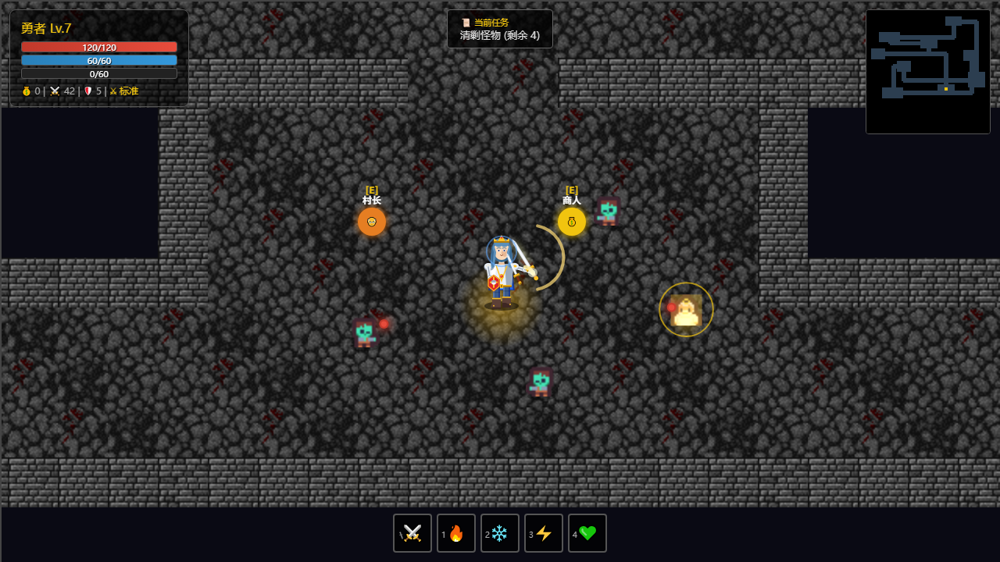
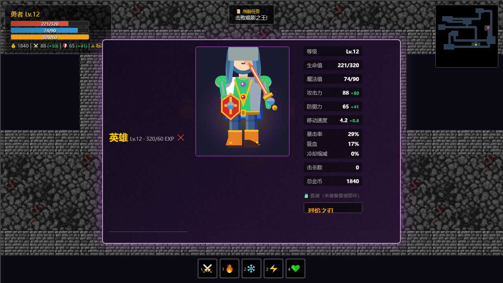
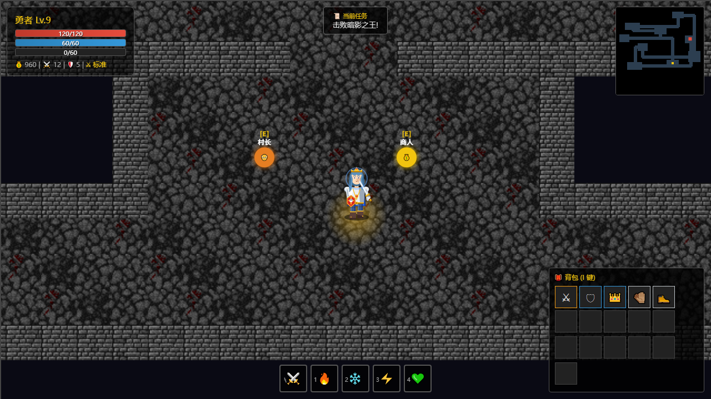

# 暗影传说 · Shadow Legend

一个纯前端的 2D 动作 Roguelike RPG，单文件 JavaScript 实现，**零依赖、零构建**，双击 `index.html` 即可游玩。


## 截图

> 图片为 1280×720 原始分辨率，GitHub 会按容器宽度缩放显示。

### 战斗



### 角色面板



### 背包与装备词条



## 快速开始

```bash
git clone https://github.com/yanghongtu/game.git
cd game
```

然后直接用浏览器打开 `index.html`。

> 也可以起个静态服务器（可选，非必需）：
> ```bash
> python -m http.server 8000
> ```
> 访问 http://localhost:8000

## 操作

| 按键 | 功能 |
|---|---|
| `W` `A` `S` `D` / 方向键 | 移动 |
| `J` / 鼠标左键 | 朝光标方向普通攻击（长按连续攻击） |
| `1` `2` `3` `4` | 释放技能 |
| `Q` | 治疗 |
| `Shift` | 闪避冲刺（带无敌帧） |
| `E` | 交互 |
| `I` | 背包 |
| `C` | 角色 / 属性面板 |
| `P` / `Esc` | 暂停 |
| `M` | 手动存档 |
| `空格` | 推进对话 |

## 玩法特色

- **实时战斗**：挥剑有攻击框与朝向，命中触发顿帧（hit stop）与屏幕震动
- **随机词条装备**：6 个装备槽位，词条强化全部战斗数值（攻击 / 防御 / 暴击 / 吸血）
- **程序生成关卡**：多阶段 Boss、精英怪词缀
- **八大精英词缀**：不同机制组合，同一场景打法不同
- **掉落保底**：连续 8 次未掉装备则必掉，稀有度随进度递增
- **三档难度**：影响敌人强度、资源产出、掉落与血量
- **四套装备套装**：2 / 4 / 6 件触发不同档位加成
- **永久升级**：死亡后可投入资源强化，降低后续难度
- **NPC 任务**与多幕剧情对话
- **像素素材**：史莱姆 / 骷髅 / 幽灵 / 灌木精灵与石板地、灰砖墙，命中、拾取、升级、低血量警报等音效

## 素材与授权

本项目使用的第三方素材**全部为 CC0 1.0（公有领域）**，可自由用于商业项目：

| 素材 | 来源 | 用途 |
|---|---|---|
| Tiny Dungeon 瓦片 | Kenney（[kenney.nl](https://kenney.nl/assets/tiny-dungeon)） | 石板地板 `floor_*.png` |
| Dungeon Crawl 瓦片 | [Dungeon Crawl Stone Soup](https://opengameart.org/content/dungeon-crawl-32x32-tiles)（CC0） | 灰砖墙 `wall_*.png` |
| Tiny Creatures 精灵 | Clint Bellanger（[OpenGameArt](https://opengameart.org/content/tiny-creatures)） | 史莱姆 / 骷髅 / 幽灵 / 灌木 |
| 512 Sound Effects | Juhani Junkala / SubspaceAudio（[OpenGameArt](https://opengameart.org/content/512-sound-effects)） | 全部音效（已转码为 Ogg Vorbis） |

原始授权文件随包保留在 `assets/CREDITS.md`。**致谢非强制，但作者都希望被提及。**

### 素材是**可选**的

删掉整个 `assets/` 目录，游戏**照常可玩**：图片退回到程序化绘制（Canvas 2D 现画的矢量造型），
音效退回到 WebAudio 振荡器现场合成。素材加载失败**不会**中断游戏，也不会拖慢开局
（加载在后台异步进行，进游戏时用哪套都行）。

> 之所以坚持「本地相对路径」而不是 CDN：README 把「双击 `index.html` 直开」当核心体验，
> 走 CDN 会让离线环境直接白屏；而且远程图片会污染 canvas（本项目有一处 `getImageData`，
> 远程图片一进来就抛 `SecurityError`）。

## 项目结构

```
.
├── index.html                 # 页面骨架 + 全部 CSS + UI 层（约 700 行）
├── game.js                    # 游戏逻辑与渲染（约 5900 行，单文件）
├── assets/
│   ├── audio/                 # 20 个 Ogg Vorbis 音效（约 176 KB）
│   ├── img/                   # 14 张 PNG：4 地板 + 4 墙 + 6 精灵（约 42 KB）
│   └── CREDITS.md             # 原始授权文件
├── docs/screenshots/          # README 用的截图
├── tools/                     # 截图生成与验证工具（见下）
└── README.md
```

### 截图与验证工具

```bash
python tools/make_screenshots.py                    # 生成三张截图到 docs/screenshots/
python tools/make_screenshots.py --out /tmp/shots   # 输出到别处（不覆盖仓库里的图）
python tools/shot_layout_check.py .                # 核对截图构图（元素位置与数量）
python tools/verify_assets.py                      # 验证素材真的画在画面上（像素断言）
```

用 headless Chrome 加载一个临时包装页，注入脚本把游戏推进到指定状态后整页截图
（含 HUD —— `canvas.toDataURL()` 抓不到 DOM 覆盖层）。

**截图是自动生成 + 自带断言的**：每个场景都有对应的像素断言与语义构图核对
（按区域检查元素的**位置与数量**），所以「驱动脚本没执行」「面板是空的」
这类问题会被当场拦下，而不是产出一张看着正常、实际内容错误的图。

> 重跑会覆盖 `docs/screenshots/` 里的图，而图中的攻击特效与粒子**每次都不同**
> （游戏动态效果）。想保留原图就加 `--out` 指定别的目录。

### 为什么另有 `cdp_run.py` / `cdp_shot.py`

**headless Chrome 的媒体栈不可用**：`<audio>` 不触发 `loadedmetadata`，
`decodeAudioData` 的 Promise 永不 settle ⇒ 用 headless 验证音效只会得到
**假阴性**（"没加载成功"其实是环境问题，不是代码问题）。

`cdp_run.py` / `cdp_shot.py` 驱动**带窗口的真实 Chrome**（通过 CDP，纯标准库实现
最小 WebSocket 客户端，无第三方依赖），并且把「起 Chrome → 连 CDP → 跑 JS → 收 Chrome」
放在**同一个进程**里完成 —— 跨 shell 命令的常驻 Chrome 进程会被环境回收。

```bash
# 在真实 Chrome 里跑一段 JS 并取回结果
python tools/cdp_run.py "file:///D:/path/index.html" "JSON.stringify({a:1})"
```

**刻意不拆分 `game.js`。** 实测结论：

- 单文件解析耗时 0.42 ms，游戏逻辑仅占 0.11% 的帧预算，60 FPS 满帧运行
- JS 运行时性能与文件组织方式**无关**，拆分成模块不会更快
- 拆分会因顶层 `const` 的词法作用域问题引发 `ReferenceError`
- 改用 ES Module 会被 `file://` 协议的 CORS 策略拦截，**破坏"双击直开"这一核心体验**

## 关于代码

`game.js` 中的战斗数值统一通过 `Player.total*` getter 读取（`totalAttack` / `totalDefense` 等），
它们会把基础属性、装备词条、套装加成、连击加成合并后返回。

> 新增战斗逻辑时**请走 `total*`，不要直接读 `player.attack` / `player.defense`** ——
> 后者只有基础值，会让装备系统的加成全部失效。

## 兼容性

需要支持 Canvas 2D 的现代浏览器（Chrome / Edge / Firefox / Safari）。
存档使用 `localStorage`，按浏览器与域名隔离。
